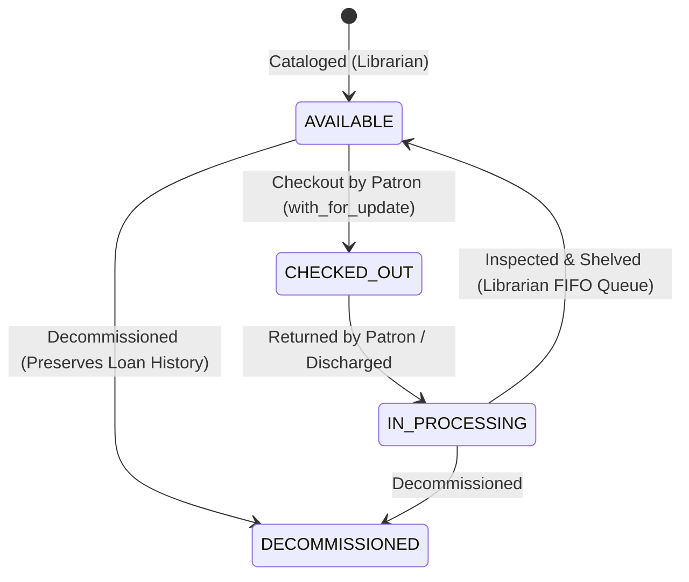
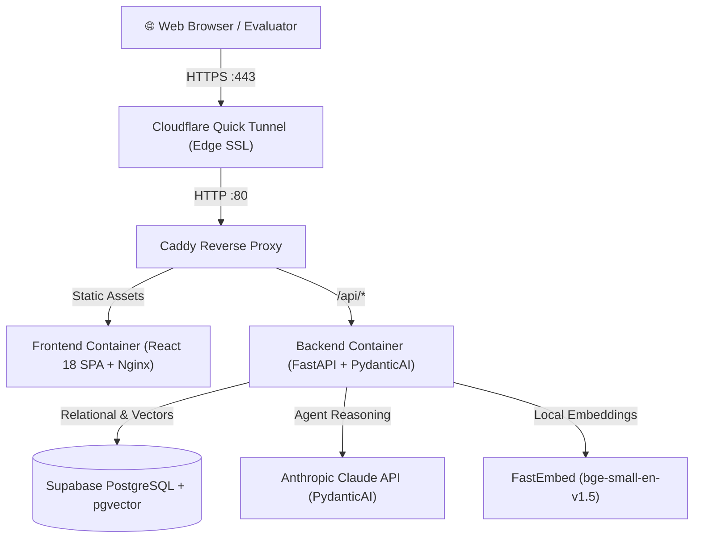

# 📚 Intelligent Library Management & Reverse Logistics System

[](https://idle-upgrades-nut-foundation.trycloudflare.com)
[](https://idle-upgrades-nut-foundation.trycloudflare.com/docs)
[](https://fastapi.tiangolo.com)
[](https://react.dev)
[](https://supabase.com)
[](https://ai.pydantic.dev)

> **Live Deployed URL:** **[https://idle-upgrades-nut-foundation.trycloudflare.com](https://idle-upgrades-nut-foundation.trycloudflare.com)**  
> **Interactive Swagger API:** **[https://idle-upgrades-nut-foundation.trycloudflare.com/docs](https://idle-upgrades-nut-foundation.trycloudflare.com/docs)**

---

## 🎯 Executive Summary & Highlights

The **Intelligent Library Management System** is a full-stack, enterprise-grade circulation and catalog platform designed for modern libraries. Built to go far beyond basic CRUD operations, it models a real-world **Reverse Logistics State Machine**, combines **hybrid keyword and semantic vector search** with `pgvector`, enforces **role-based access control (RBAC)** via Google SSO and 1-click test roles, and integrates an **Autonomous AI Librarian Assistant** powered by **PydanticAI**.

### Feature Completeness Checklist

| Category | Requirement / Feature | Status | Implementation Details |
| :--- | :--- | :---: | :--- |
| **Core CRUD** | Book Management | ✅ | Add, edit, catalog, and decommission books with ISBN, genre, year, Dewey Decimal, and cover URLs. |
| **Circulation** | Check-in / Check-out | ✅ | 14-day loan lifecycle with dynamic overdue calculation and history tracking. |
| **Search** | Hybrid Search | ✅ | Substring search across title, author, and summaries + semantic vector search (`pgvector`). |
| **Bonus: Auth** | Authentication & RBAC | ✅ | Google Single Sign-On (SSO) + 1-click **Demo Patron** and **Demo Librarian** accounts. |
| **Bonus: AI** | AI Librarian Assistant | ✅ | Multi-turn conversational agent with live tool execution (catalog search, availability check, borrowing). |
| **Bonus: Deploy** | Live Production URL | ✅ | Fully deployed and accessible over HTTPS with zero installation required. |
| **Bonus: Logistics**| Reverse Logistics Desk | ✅ | Returned items enter `IN_PROCESSING` intake queue with FIFO shelving workflows. |
| **Hardening** | Concurrency Protection | ✅ | Row-level locking (`with_for_update`) and PostgreSQL partial unique index on active loans. |

---

## 🏛️ System Architecture

### 1. Reverse Logistics Inventory State Machine
Physical assets transition deterministically across four lifecycle states:



### 2. Multi-Container Production Topology


---

## ⚡ 60-Second Evaluator Guide (No Setup Required!)

To evaluate the system immediately without installing any software locally:

1. Open **[https://idle-upgrades-nut-foundation.trycloudflare.com](https://idle-upgrades-nut-foundation.trycloudflare.com)**.
2. In the navigation bar, click **Sign In** to navigate to the authentication page.
3. Test with **1-Click Preset Roles**:
   - **Click "Sign In as Patron"**:
     - Browse the 15 pre-seeded books in Grid or Table view.
     - Toggle **Semantic Search** and type queries like *"system kernel virtualization"* or *"clean maintainable code"*.
     - Check out an available book.
     - View **My Loans** to see active borrowings and overdue indicators.
     - Open the **AI Librarian** chat widget in the bottom-right and ask: *"Can you recommend a book on distributed systems and check if it's available?"*.
   - **Click "Sign In as Staff"**:
     - Access the **Triage Desk** to inspect returned books in the `IN_PROCESSING` queue.
     - Click **"Shelve Volume"** to transition items back to `AVAILABLE`.
     - Catalog a new book or edit book metadata.
4. *(Optional)* Click **"Continue with Google"** to test real Google OAuth Single Sign-On!

---

## 💻 Local Machine Quickstart

### Prerequisites
- [Docker](https://docs.docker.com/get-docker/) & [Docker Compose v2](https://docs.docker.com/compose/)
- *(Optional for source build)* Python 3.11+ with [uv](https://docs.astral.sh/uv/) and Node.js 18+

### Method 1: One-Command Docker Boot (Recommended)

```bash
# 1. Clone repository
git clone https://github.com/hcleungca/library-management.git
cd library-management

# 2. Configure environment
cp .env.example .env
# Edit .env with your database and API keys if needed

# 3. Start all containers
docker compose up -d --build

# 4. Run database migrations & seed 15 curated books
docker compose exec backend alembic upgrade head
docker compose exec backend python -m scripts.seed

# 5. Open in browser
open http://localhost:8080
```

---

### Method 2: Running from Source (Local Development)

#### 1. Backend Setup
```bash
cd backend
uv sync
uv run alembic upgrade head
uv run python -m scripts.seed
uv run uvicorn app.main:app --reload --port 8000
```
API runs on `http://localhost:8000`. Swagger docs at `http://localhost:8000/docs`.

#### 2. Frontend Setup
```bash
cd frontend
npm install
npm run dev
```
Frontend runs on `http://localhost:3000` with automated proxying to `:8000`.

---

## 🔬 Engineering & Design Deep Dive

### 1. Concurrency Protection & Zero Double-Booking
Circulation systems often suffer from race conditions when two patrons attempt to check out the last available copy simultaneously.
- **Pessimistic Row-Level Locking:** During checkout and shelving, the database row is locked using SQLAlchemy's `with_for_update()`:
  ```python
  book = db.query(Book).filter(Book.id == book_id).with_for_update().first()
  if book.status != "AVAILABLE":
      raise HTTPException(status_code=409, detail="Book already checked out")
  book.status = "CHECKED_OUT"
  ```
- **PostgreSQL Partial Unique Constraint:**
  ```sql
  CREATE UNIQUE INDEX idx_unique_active_loan_per_book 
  ON loans (book_id) WHERE status = 'ACTIVE';
  ```
  Even under concurrent distributed transactions, the database engine physically rejects duplicate active loans at the storage layer.

### 2. Audit Trail & Smart Decommissioning
Deleting physical catalog records should never destroy patron borrowing history.
- If a book has **no loan history**, deleting it performs a clean hard delete.
- If a book has **past circulation records**, the deletion workflow automatically performs a **soft decommissioning**:
  - The record's status becomes `DECOMMISSIONED`.
  - The ISBN is cleared to allow re-cataloging newer editions under that ISBN.
  - Historical loan references are preserved so patron reading history never breaks.

### 3. Semantic Vector Search with `pgvector` & `FastEmbed`
- Books are converted into dense vector embeddings locally using **FastEmbed** (`BAAI/bge-small-en-v1.5`, normalized to 1536 dimensions) without external API dependencies, costs, or network latency.
- Features deterministic fallback vector generation for test suites and offline CI environments.
- Search queries compute cosine similarity distance directly inside PostgreSQL via an HNSW index:
  ```sql
  SELECT *, 1 - (embedding <=> :query_vector) AS similarity
  FROM books
  WHERE embedding IS NOT NULL
  ORDER BY similarity DESC
  LIMIT :limit;
  ```
- Provides instant conceptual search (e.g., searching *"how to write robust software"* retrieves *Clean Code* even without exact keyword matches).

### 4. Autonomous Agent Architecture (PydanticAI)
The AI Librarian assistant uses **PydanticAI** with native dependency injection (`RunContext`):
- **Tools Registered:**
  - `search_catalog`: Performs hybrid semantic/keyword search.
  - `check_availability`: Queries physical copy status.
  - `recommend_books`: Recommends curated titles based on preferences.
  - `checkout_book`: Executes checkout on behalf of the patron directly through circulation business logic.
- **Why PydanticAI over LangChain:**
  - Type-safe input/output schemas with Pydantic v2.
  - Explicit dependency injection (`deps.db`, `deps.user`) preventing patron identity spoofing.
  - Lightweight, deterministic tool execution without heavy dependency trees.

---

## 📁 Repository Structure

```text
├── backend/
│   ├── alembic/              # Database migration versions
│   ├── app/
│   │   ├── api/              # FastAPI endpoints (books, circulation, auth, search, ai)
│   │   ├── core/             # Configuration, auth dependencies, RBAC
│   │   ├── db/               # SQLAlchemy engine & session factory
│   │   ├── models/           # ORM models (Book, Loan, Profile)
│   │   ├── schemas/          # Pydantic validation schemas
│   │   └── services/         # PydanticAI agent, vector search, embeddings
│   ├── scripts/              # Database seeding & embedding backfill scripts
│   ├── tests/                # Comprehensive pytest suite (unit & integration)
│   ├── Dockerfile            # Multi-stage production container build (uv)
│   └── pyproject.toml        # Backend dependencies & tools
├── frontend/
│   ├── src/
│   │   ├── components/       # Catalog, circulation, modals, AI widget, auth
│   │   ├── context/          # RoleContext (Auth state & token sync)
│   │   ├── hooks/            # TanStack Query custom hooks
│   │   └── lib/              # API client & Supabase auth
│   ├── Dockerfile            # Production multi-stage Nginx container
│   ├── nginx.conf            # SPA routing & caching
│   └── package.json          # Frontend dependencies
├── Caddyfile                 # Production reverse proxy configuration
├── docker-compose.yml        # Multi-container orchestration
└── README.md                 # Project documentation
```

---

## 🧪 Testing & Code Quality

The backend features test suites covering models, schemas, API endpoints, authentication, concurrency, and agent tools:

```bash
cd backend
uv run pytest -v
```

---

## 📄 License

This project is licensed under the [MIT License](LICENSE).

